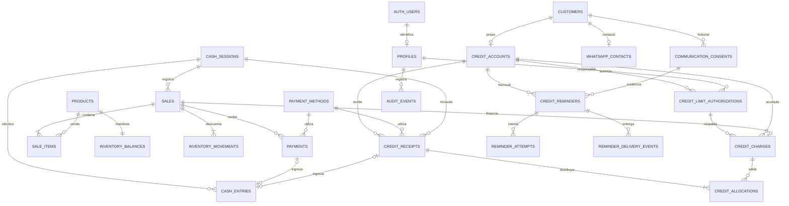
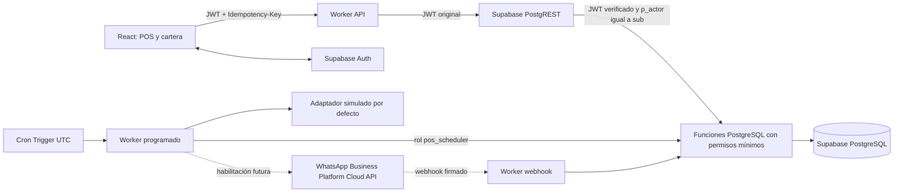

# Créditos y cuentas por cobrar — ampliación del diseño

Estado: diseño y migraciones propuestas, sin aplicar a Supabase. No hay Worker desplegado, conexión del frontend ni mensajes reales. Este documento actualiza la propuesta anterior antes de generar SQL. La interfaz existente permanece intacta durante esta etapa de arquitectura y migraciones.

## 1. Reglas confirmadas y decisiones explícitas

- Una tienda, moneda COP, cantidades enteras, fechas comerciales en `America/Bogota`.
- Cada cliente tiene una cuenta de crédito. El cupo es para la deuda acumulada de la cuenta, no por compra.
- Cajero, supervisor y administrador pueden autorizar cupos y vender a crédito. Cada autorización es un registro nuevo con autor, fecha, importe anterior, importe nuevo y motivo; nunca se sobrescribe.
- La autorización no se hereda del rol mostrado en React: la función SQL verifica un perfil activo. El Worker pasa exclusivamente el sujeto del JWT verificado.
- El cupo disponible es `último cupo autorizado − suma de saldos de todas las obligaciones`. No se excluyen créditos vencidos. No se permite bajar el cupo por debajo de la deuda.
- Compras del 1 al 28 inclusive: vencimiento el 28 del mismo mes. El crédito vence al terminar ese día local; aparece vencido desde el 29. El recordatorio se prepara el propio 28, sin llamarlo todavía moroso.
- Compras posteriores al 28: vencimiento el 28 del mes siguiente, incluido el cambio de año. La fecha nunca precede a la compra; `credit_charges_due_policy` exige igualdad con `pos.credit_due_date(purchased_on)`.
- La venta puede combinar efectivo, transferencia y otros medios recibidos con una porción financiada. `Crédito` es una opción de liquidación del POS, no un pago recibido en `payments`.
- `principal financiado = total de venta − pagos recibidos al vender`. El abono inicial se conserva como pago de la venta, no se vuelve a registrar como un abono posterior.
- Cada abono posterior se distribuye FIFO: fecha de compra, fecha de creación e ID como desempate. Se atiende primero la obligación más antigua, aunque varias venzan el mismo día.
- Importe positivo con máximo dos decimales, menor o igual a la deuda actual. No hay sobrepagos, intereses, refinanciaciones, condonaciones ni borrados de abonos en esta entrega.
- Estado calculado: `paid` cuando el saldo es cero; `overdue` cuando queda saldo y pasó la fecha local de vencimiento; `active` en los demás casos. No se modifica un saldo/estado manual desde React.
- Se exige caja abierta para ventas y abonos; solo los medios `affects_cash=true` generan entradas de efectivo. Una transferencia cuenta como recaudo, no como billetes en caja. Una cuenta por cobrar no cuenta como recaudo.
- Los pagos y autorizaciones confirmados son inmutables. Las devoluciones del diseño anterior necesitarán una nota de crédito integrada en la misma transacción de devolución; esta base mínima no ofrece todavía un endpoint de devoluciones ni permite borrar ventas para compensarlas.

## 2. Modelo entidad-relación actualizado

Tablas financieras: `sales`, `sale_items`, `payments`, `inventory_movements`, `cash_entries`, `credit_limit_authorizations`, `credit_charges`, `credit_receipts`, `credit_allocations`. Son append-only para el rol de aplicación. Los saldos se derivan de principal y distribuciones, sin una columna editable de cartera.

| Tabla de crédito              | Campos y restricciones principales                                                                                                    |
| ----------------------------- | ------------------------------------------------------------------------------------------------------------------------------------- |
| `credit_accounts`             | UUID, cliente único, activo, creación; fila usada como bloqueo de concurrencia                                                        |
| `credit_limit_authorizations` | cuenta, responsable, fecha, cupo anterior/nuevo, motivo e ID secuencial de orden; historial inmutable                                 |
| `credit_charges`              | cuenta, venta única, principal, autorización, compra y vencimiento; día 28 del mes actual para compras 1–28, del siguiente para compras posteriores |
| `credit_receipts`             | cuenta, importe, método, referencia, sesión de caja, responsable, fecha; no se acepta el método crédito                               |
| `credit_allocations`          | abono, obligación, importe; FK compuestas aseguran misma cuenta; una asignación por abono/obligación                                  |
| `whatsapp_contacts`           | cliente único, E.164, verificación del número, versión/fecha; cambiar número invalida verificación y consentimiento previo            |
| `communication_consents`      | historial de otorgamiento/revocación, teléfono exacto, propósito `credit_reminder`, evidencia, fuente, actor y fecha                  |
| `credit_reminders`            | cuenta, período mensual, estado, importe/contacto/consentimiento al preparar despacho, proveedor, ID de mensaje; único cuenta/período |
| `reminder_attempts`           | recordatorio, número de intento, token de despacho, inicio/fin, resultado y código del proveedor; sin payload con PII en logs         |

`reminder_delivery_events` conserva eventos de entrega por proveedor con una clave ?nica; un webhook repetido no duplica el historial y los eventos fuera de orden no hacen retroceder `read` a `delivered`. La verificaci?n HTTP de firma pertenece al Worker futuro.

Vistas: `credit_charge_balances`, `credit_account_balances`, `credit_receipt_history`. El rol del Worker no tiene SELECT directo: usa funciones de consulta con comprobación de permisos. Las verificaciones globales de sumas se refuerzan con constraint triggers diferidos, además de los bloqueos de las funciones.

## 3. Arquitectura y límites de confianza

- El Worker financiero validará el JWT con Supabase Auth (`getClaims`/JWKS o `getUser` verificado por el servidor), comprobará emisor del proyecto, audiencia `authenticated`, expiración y sujeto. Reenviará el JWT original a RPC de PostgREST, que verifica nuevamente la firma. No usará una conexión SQL compartida ni `service_role` para movimientos de empleados.
- `pos_owner` es propietario NOLOGIN de tablas, vistas y funciones; el esquema permanece propiedad del administrador de migraciones. Las funciones SECURITY DEFINER tienen search_path fijo y objetos cualificados. RLS se habilita y ningún cliente recibe permisos de tabla; el propietario puede operar internamente. Los perfiles activos se consultan en PostgreSQL, sin confiar en roles enviados por React ni `user_metadata`.
- La futura configuración de Data API expondrá `pos` solo para RPC explícitamente concedidas a `authenticated`. Las tablas, vistas, helpers y funciones del programador no reciben permisos de ese rol. `require_staff` exige sesión `authenticator`, JWT de rol `authenticated` vigente y `p_actor = sub`. El Worker rechaza `p_actor`/`actor_id` del body y usa el sujeto verificado. Una llamada directa a la API mantiene los mismos controles SQL. No se permite exponer una función que cambie `request.jwt.claims` o ejecute SQL arbitrario.
- No otorgar `pos_owner`, `pos_app` ni `pos_scheduler` a `authenticator`, `authenticated` o `anon`. `pos_app` queda como rol técnico reservado, sin acceso financiero directo desde SQL: los parámetros GUC no verifican una firma. El programador usará una credencial separada limitada a `pos_scheduler`; solo transporte mock. Los roles NOLOGIN no tienen contraseñas. La credencial de `authenticator` pertenece exclusivamente al gateway de Supabase.
- Bloqueos financieros: cuenta de crédito → sesión de caja → productos/saldos en orden UUID. Abonos, cupos, ventas y predespacho comparten el bloqueo de cuenta. Una consulta previa desde React no autoriza una venta.
- Las operaciones de personal, claim y preflight exigen READ COMMITTED: después de esperar un bloqueo vuelven a consultar la cartera. Reintentar deadlocks/errores transitorios con la misma clave, nunca generar otra venta. No conservar un snapshot REPEATABLE READ para una operación financiera.
- La idempotencia persiste clave, operación, actor, petición canónica y resultado dentro de la misma transacción. Los reintentos con otra carga se rechazan; no se elimina el registro de una operación financiera confirmada.
- Invitación/alta de empleados, cierre de caja completo, proveedores, gastos y devoluciones siguen siendo integraciones del diseño general previo. La migración base solo implementa sus dependencias mínimas para créditos; no es toda la aplicación comercial.

## 4. POS y módulo de cartera: contrato de integración de interfaz

La siguiente etapa conectará el frontend existente, sin presentar la simulación como un backend operativo:

- En POS, opción Crédito y selector obligatorio de cliente. Mostrar WhatsApp enmascarado, deuda, cupo autorizado, utilizado/disponible, total, pagos iniciales, financiado y vencimiento proporcionado por el servidor.
- Separar el formulario de autorización de cupo del de venta. Si hace falta ampliar cupo, primero registrar nueva autorización y después revalidar la venta. Conservar ambas operaciones aunque la venta no se confirme.
- Mostrar el vencimiento calculado por el servidor también después del 28, cuando corresponde al mes siguiente. La regla no bloquea ventas financiadas al finalizar el mes.
- Nueva navegación: **Créditos y cuentas por cobrar**. Indicadores: cartera total (saldo), activos/vencidos/pagados (número de obligaciones), clientes deudores y recaudo mensual.
- Recaudo mensual: pagos iniciales de ventas financiadas + abonos posteriores recibidos en el mes; nunca incluye principal no cobrado. Métodos no efectivos cuentan como recaudo, sin afectar efectivo esperado.
- Detalle por cliente: compras originales, responsables, cupos, distribuciones FIFO, abonos, saldos y recordatorios/intentos. Un abono no altera ventas históricas.
- Filtros: cliente, estado y rango de fecha de compra para obligaciones. Historial de abonos por fecha de recaudo; recordatorios por período/fecha de intento. Los indicadores globales no cambian con los filtros de tabla; el servidor devuelve claramente su alcance.

## 5. API propuesta

Prefijo `/api/v1`. Lecturas paginadas; importes decimales como cadenas. Para cada escritura: JWT verificado, validación del servidor, auditoría e `Idempotency-Key` cuando haya efecto financiero.

| Método / ruta                                     | Contrato                                                                                                                            |
| ------------------------------------------------- | ----------------------------------------------------------------------------------------------------------------------------------- |
| `GET /customers/:id/credit`                       | deuda, cupo, disponible, contacto enmascarado, versión de autorización                                                              |
| `POST /customers/:id/credit-limit-authorizations` | nuevo cupo, motivo; actor tomado del JWT; cajeros permitidos                                                                        |
| `POST /sales`                                     | productos/cantidades, cliente, pagos recibidos y `financeRemainder`; precios, stock, saldo y vencimiento recalculados en PostgreSQL |
| `GET /credits`                                    | cliente, estado, `purchasedFrom`, `purchasedTo`, cursor y límite                                                                    |
| `GET /credits/summary`                            | indicadores globales y período de recaudo mensual                                                                                   |
| `GET /credits/:id`                                | obligación, venta, responsable, saldo y distribuciones                                                                              |
| `GET /customers/:id/credit-history`               | compras, abonos, cupos y recordatorios                                                                                              |
| `POST /customers/:id/credit-receipts`             | importe, método, referencia y caja; FIFO automático en una transacción                                                              |
| `PUT /customers/:id/whatsapp-contact`             | número E.164; verificar posesión mediante flujo posterior, sin asumir que E.164 prueba titularidad                                  |
| `POST /customers/:id/communication-consents`      | otorgar/revocar, teléfono, propósito y evidencia; sin consentimiento implícito por comprar                                          |
| `GET /credit-reminders`                           | historial con resultados e intentos, teléfono enmascarado                                                                           |
| `POST /webhooks/whatsapp`                         | validar firma sobre body original, deduplicar evento y actualizar entrega sin volver a enviar                                       |

Funciones SQL financieras implementadas por estas migraciones: `authorize_credit_limit`, `confirm_sale`, `record_credit_receipt`. Consultas `get_credit_account`, `list_credits`, `credit_summary`, `get_credit_history`. Funciones del programador: `enqueue_credit_reminders`, `claim_credit_reminder`, `preflight_credit_reminder`, `finish_credit_reminder` y `record_reminder_delivery`. El contrato HTTP y la verificación de webhooks quedan diseñados, no desplegados.

Errores de negocio reconocibles: `CREDIT_LIMIT_EXCEEDED`, `LIMIT_BELOW_DEBT`, `INVALID_AMOUNT`, `AMOUNT_EXCEEDS_DEBT`, `CASH_SESSION_NOT_OPEN`, `IDEMPOTENCY_CONFLICT`, `FORBIDDEN`, `FORBIDDEN_ACTOR`, `UNTRUSTED_AUTH_CONTEXT`, `READ_COMMITTED_REQUIRED`. El Worker mapeará errores de negocio a 409/422 y autorización a 403; un contexto o aislamiento de servidor mal configurado requiere corregir la integración. Nunca retornar errores SQL internos ni tokens.

## 6. Recordatorios de WhatsApp

El Cron de preparación propuesto es `0 14 28 * *`: 09:00 de Bogotá el 28. Cloudflare ejecuta cron en UTC. Un segundo Cron `*/5 * * * *` atenderá pendientes y reintentos, únicamente el 28 local entre 09:00 y 18:00. Ambos comprueban fecha local y deduplican el período; no se depende de que el evento se ejecute exactamente una vez.

1. Preparar una fila por cuenta y mes con deuda > 0. La agrupación incluye todas las obligaciones pendientes, también vencidas de meses anteriores.
2. Antes de cada despacho, volver a bloquear cuenta y comprobar saldo, contacto verificado y último consentimiento del teléfono actual.
3. Si el saldo es cero, cancelar el recordatorio. Si falta autorización/contacto, registrar `skipped` con motivo, no intentar HTTP.
4. Congelar importe total, fecha de corte, teléfono y consentimiento como evidencia de ese intento; no enviar documentos de identidad, detalle de productos ni enlaces con credenciales.
5. Reservar intento exclusivo y token; enviar mediante adaptador oficial futuro. En desarrollo el adaptador es mock y no incluye llamadas a Meta.
6. Registrar aceptación y message ID de Meta. `accepted` no significa `delivered`: confirmar entregas por webhook firmado y deduplicado.
7. Máximo tres intentos. Reintentar solamente un rechazo inequívoco sin aceptación, con espera 5 y 15 minutos y dentro de la ventana del mismo día. Cada reintento recalcula saldo y consentimiento.
8. Un timeout, desconexión o resultado incierto pasa a `unknown`; no reintentar ciegamente. Los intentos `dispatching` cuyo Worker desaparezca también requieren reconciliación, nunca reenviar por vencer una lease.
9. Tras aceptación no enviar otro mensaje ese mes, incluso si el webhook de entrega tarda o falla. Un cambio de proveedor no permite otra fila mensual.

Plantilla candidata, pendiente de revisión y aprobación: «Hola {{nombre}}, al {{fecha_corte}} tienes un saldo pendiente de {{total}} COP en {{tienda}} por compras realizadas. Si necesitas revisar tus pagos, comunícate con la tienda.»

**Límites explícitos:** la reserva SQL y el envío HTTP no forman una transacción distribuida. No se promete entrega exactamente una vez del proveedor. Se garantiza un recordatorio lógico por cliente/mes y se evita el reenvío automático de resultados ambiguos. Un pago confirmado antes de la reserva final suprime el envío; un pago posterior a la reserva puede coincidir con un mensaje ya en tránsito. La plantilla lleva una fecha de corte. La condición debe revisarse nuevamente inmediatamente antes del HTTP en el Worker futuro, sin mantener bloqueos SQL durante una llamada externa.

La política oficial exige opt-in y plantillas aprobadas para iniciar conversaciones; también enumera restricciones sobre debt collection. No se presume que recordar cuentas propias de una tienda sea automáticamente elegible. **No activar transporte real hasta validar el caso con Meta/BSP, la plantilla y la política aplicable.** Esta entrega solo genera SQL y pruebas sin transporte de red.

## 7. Plan de migraciones

| Archivo                                       | Contenido                                                                              |
| --------------------------------------------- | -------------------------------------------------------------------------------------- |
| `20261023000100_pos_credit_prerequisites.sql` | Dependencias mínimas del POS, perfiles, clientes, productos, pagos/caja e idempotencia |
| `20261023000200_credit_ledger.sql`            | Cuentas, cupos, obligaciones, abonos, FIFO, integridad, vistas y funciones atómicas    |
| `20261023000300_credit_reminders.sql`         | Contactos, consentimiento histórico, recordatorios, reservas e intentos sin transporte |
| `20261023000400_credit_access.sql`            | Propiedad, RLS, revocaciones y EXECUTE mínimo; no credenciales                         |

Son migraciones para una base nueva: la propuesta anterior no se había implementado. No usan `CREATE TABLE IF NOT EXISTS` para esconder un esquema incompatible. Si existe una base real con otros nombres/columnas, realizar primero un relevamiento y una migración de adaptación; no aplicar estos archivos directamente sobre ella.

## 8. Pruebas y próximas etapas

Ver `README.md` de esta carpeta y `tests/credit/credit-db.spec.ts`. Validación con PostgreSQL embebido PGlite, usando Playwright como runner sin navegador ni red. El fixture crea `auth.users`, roles ficticios y contexto de gateway; **no verifica firmas ni crea identidades reales**. Las migraciones se cargan con un rol CREATEROLE sin superusuario. PGlite serializa consultas: no sustituye la validación de Auth/PostgREST ni las pruebas multi-conexión en un proyecto de pruebas alojado, pendientes de autorización. Esta etapa no utiliza Docker.

Fuentes oficiales consultadas el 23-10-2026:

- [Cloudflare Cron Triggers: UTC y scheduled handler](https://developers.cloudflare.com/workers/configuration/cron-triggers/).
- [WhatsApp Business Messaging Policy: consentimiento, plantillas y restricciones](https://whatsappbusiness.com/policy/).
- [WhatsApp Developer Hub](https://whatsappbusiness.com/developers/developer-hub/). Algunas páginas técnicas de Meta devolvieron 429 durante esta revisión: volver a verificar versión Graph API y contrato de webhooks antes de implementar el adaptador real.
- [PostgreSQL: bloqueos por fila y SKIP LOCKED](https://www.postgresql.org/docs/current/sql-select.html).
